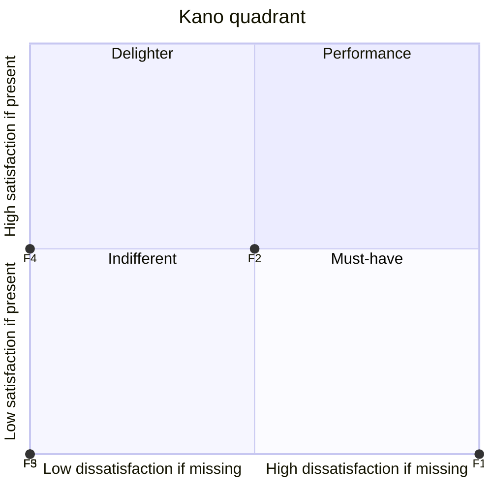
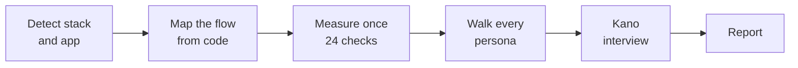

<p align="center">
  
</p>

<h1 align="center">DayZero</h1>

<p align="center">
  <b>The synthetic crowd engine. Like Reddit, but you own the users.</b><br>
  Validate your PMF and get Kano Model reports using your own local LLM (Cursor/Claude) without exposing your code.
</p>

<p align="center">
  
  
  
  
</p>

---

You can ship a SaaS in a weekend now. Finding out whether anyone wants it still takes recruiting, calls, and a notebook full of maybes, so most builders skip it and launch into silence.

DayZero puts a crowd of opinionated, hard-to-please people inside your IDE. They read your actual code, walk your actual signup flow, and tell you where they quit and why. You get the answer before you spend a single real user on it.

## 1 command, 1 real run

We pointed DayZero at **Tickly**, a small Next.js todo app from our test set, and typed 1 line in Claude Code:

```
@.dayzero validate
```

About 4 minutes later, read-only, this came back:

> **Verdict: FIX** · Stack `nextjs-react` · Flow `first_value` · 3 personas, directional

> "4 required fields and a company name for a todo list? It's just me, and I'm closing the tab."
> **Dev Malik**, indie hacker, at step 2: Sign up

> "4 required fields and no SSO. I'm not opening a security review for a todo list."
> **Rachel Okafor**, burned-out PM, at step 2: Sign up

> "No phone number, no address, nothing. Who do I call when this breaks? I'm not signing up for that."
> **Gary Hollis**, skeptical business owner, at step 1: Landing

And the line that mattered most:

> **Fix first:** email verification is a dead end. `middleware.ts` sends every unverified user back to `/verify-email`, and no file in the repo ever sets the verified cookie. Until that changes, 0% of real signups reach the dashboard.

Nobody planted that bug. The crowd found it by reading the code.

## Quick start

**1. Copy `.dayzero/` into the root of your project.**

```
your-project/
├── .dayzero/
├── src/
└── ...
```

**2. Ask your assistant.** In Cursor or Claude Code:

```
@.dayzero validate
```

**3. Open the report** at `.dayzero/reports/dayzero-report-YYYY-MM-DD.md`.

That's the whole install. There is no package, no server, and no script that runs on its own.

## What's in the report

| Section | What you learn |
|---|---|
| **Executive summary** | SHIP, FIX, or KILL. How many personas reached first value. The 1 change to make first, tied to a file. |
| **Funnel** | Every step of your flow with the file behind it, a measurement sheet (clicks, form fields, OAuth, price, permissions, contrast and more), and who left where, by which rule. |
| **Kano matrix** | Your 5 core features classified as Must-have, Performance, Delighter, Indifferent, or Reverse, with Better/Worse coefficients and a quadrant chart. |
| **Kano interview** | Each persona's answer to each feature from a fixed list, plus the few who broke from the crowd, in their own words. |
| **Top 3 quotes** | The lines you will remember in the shower. |

Here is the quadrant from the Tickly run, exactly as the report draws it:



F1 is todo capture (Must-have), F2 email reminders, F3 team invites (Reverse for 2 of 3), F4 AI prioritize, F5 streaks and badges.

## How it works

<p align="center">
  
</p>

DayZero is a folder of Markdown and JSON. Your assistant reads `system_protocol.md` and runs it like a program, on your machine, with your model.



1. **Detect** the stack and the app, then load the matching guide from `.dayzero/stacks/`.
2. **Map** the flow you asked for, step by step, each step tied to a file.
3. **Measure** the product once against 26 shared definitions in `measurements.json`. Every persona judges the same numbers, so runs stay comparable.
4. **Walk** each persona through the flow. Their rules fire on the measured values and decide where they quit.
5. **Interview** each persona about each feature with the 2 Kano questions. Answers come from 1 fixed list of 5 lines. Only a persona who breaks from the crowd, or from its own profile, answers in its own words.
6. **Report**, following the template section by section.

The personas run in Critic Mode. Praise, hedging, and compliment sandwiches are banned. A persona with a 3-click budget leaves at click 4, however nice the feature behind it is.

## The crowd

DayZero comes with 28 ready personas. You don't have to write any.

Every persona below runs on structured rules with tests, so the same code gets the same drops on every run. Free ones ship in this repo. **Pro** ones come with the Pro Pack.

| Persona | Edition | Leaves when |
|---|---|---|
| `indie_hacker` | Free | Signup asks for more than email and password, or a free trial needs a card |
| `tired_pm` | Free | First value takes more than 3 clicks, or the first screen is empty |
| `skeptical_boomer` | Free | No human to contact, an app install to try it, or data asked before explaining why |
| `api_first_junior_analyst` | **Pro** | No public API, or API limits too low to sync daily |
| `night_shift_indie_builder` | **Pro** | No free tier with API access, no public docs |
| `paranoid_devsecops_admin` | **Pro** | No SAML or OIDC SSO, no compliance page |
| `crypto_degen_trader` | **Pro** | Any request for a seed phrase or private key |
| `five_second_ceo` | **Pro** | Empty first screen or a setup wizard |
| `roi_driven_pm` | **Pro** | No price, no measurable result before a contract |
| `density_first_banker` | **Pro** | No keyboard shortcuts, fewer than 20 values on screen |
| `change_averse_accountant` | **Pro** | No export, no print view |
| `privacy_first_hr_director` | **Pro** | No role-based access or audit log |
| `cost_cutting_clinic_director` | **Pro** | No visible price, no data compliance statement |
| `speed_obsessed_sales_rep` | **Pro** | More than 3 fields to log a call, core screens with no loading state |
| `anxious_health_seeker` | **Pro** | No human to contact, no stated response time |
| `elderly_patient_low_vision` | **Pro** | Text under 16px, low contrast, code-only login |
| `overloaded_shift_nurse` | **Pro** | Routine entry takes more steps than paper, input lost on timeout |
| `broke_genz_student` | **Pro** | No free tier, card before value |
| `budget_tracking_parent` | **Pro** | Total price hidden until the last step, no renewal reminder |
| `fraud_wary_pensioner` | **Pro** | No phone support, bank or ID details without a reason |
| `impulse_shopper` | **Pro** | No 1-tap wallet, account before payment |
| `luxury_concierge_buyer` | **Pro** | No named human contact, visible errors |
| `speed_courier` | **Pro** | More than 2 taps for a routine action, blocking splash |
| `on_the_move_rideshare_driver` | **Pro** | Small text or tap targets, no offline state |
| `voice_first_site_foreman` | **Pro** | No voice input, low contrast |
| `mobile_only_fitness_coach` | **Pro** | Any core action impossible on a phone |
| `keyboard_native_cashier` | **Pro** | No keyboard shortcuts for core actions |
| `lead_hungry_plumber` | **Pro** | Pricing with no link to leads or jobs |

Rules read shared measurements. 26 are free in [`measurements.json`](.dayzero/measurements.json); 39 **Pro** ones come in `measurements.pro.json` and load only when the Pro Pack is installed.

<details>
<summary>All 65 measurements</summary>

| Measurement | Edition | Level | What it checks |
|---|---|---|---|
| `clicks_to_value` | Free | step | Clicks, taps, and submits from the first screen up to this step |
| `steps_to_value` | Free | product | Number of distinct screens or pages from the first screen to first value, both included |
| `form_fields` | Free | step | Required input fields the user must fill to leave this step |
| `wait_required` | Free | step | The user must wait for something outside the product to continue |
| `empty_state_without_sample` | Free | step | The first screen after signup shows no data and offers no sample data, template, or demo content |
| `oauth_present` | Free | product | At least 1 third-party sign-in (Google, GitHub, Apple, SSO) is wired in |
| `email_domain_restricted` | Free | product | Signup rejects some email domains |
| `password_constraints` | Free | product | Number of password rules beyond a minimum of 8 characters |
| `email_verification_required` | Free | product | The user cannot reach first value before verifying their email |
| `free_tier_present` | Free | product | A plan or mode exists that reaches first value without paying and without a card |
| `card_before_value` | Free | product | Card or payment details are required before first value on the default path |
| `install_required_to_try` | Free | product | First value needs installing something first |
| `lowest_paid_usd_month` | Free | product | Lowest monthly price for 1 user on any paid plan, converted to USD per month |
| `price_visible` | Free | product | A price amount is shown to visitors before signup |
| `contact_human_visible` | Free | product | Public pages show at least 1 of: phone number, physical address, named support email |
| `permission_requests_before_value` | Free | product | Device or data permission prompts shown before or at first value |
| `permission_explained` | Free | product | Every permission prompt before first value is preceded by a plain-language reason on the same screen |
| `export_present` | Free | product | The user can export their own data |
| `api_present` | Free | product | A documented or token-authenticated public API exists for users |
| `data_exit_present` | Free | product | The user can get their own data out by at least 1 route: file export, a token-authenticated public API, or a CLI command that reads it |
| `unexplained_jargon_terms` | Free | step | Distinct terms on this screen from the jargon list that are not explained on the same screen |
| `adds_notifications` | Free | feature | The feature sends email, push, or in-app notifications, or adds a badge or inbox |
| `team_push_before_value` | Free | product | The flow asks the user to invite teammates or create a team before first value |
| `ai_label_without_outcome` | Free | feature | The feature is labelled AI and the label states no concrete result |
| `min_body_font_px` | Free | product | Smallest font size used for body or action text on public and onboarding screens |
| `low_contrast_text` | Free | product | Body or action text on public or onboarding screens uses a color under WCAG AA 4.5:1 contrast against its background |
| `phone_support_visible` | **Pro** | product | Public pages show a phone number for support or sales |
| `support_response_time_stated` | **Pro** | product | A support response time is shown in the product or on public pages |
| `compliance_statement_visible` | **Pro** | product | A public page states where data is stored and for how long, a DPA, or a certification |
| `enterprise_sso_present` | **Pro** | product | SAML or OIDC enterprise single sign-on is wired in code |
| `otp_only_login` | **Pro** | product | Sign-in needs a one-time code and offers no other method |
| `access_audit_present` | **Pro** | product | Role-based permissions limit who can see or edit records, and access or changes are logged per user |
| `secret_key_requested` | **Pro** | product | A form asks for a seed phrase, private key, recovery words, or a full password for another service |
| `sends_user_data_to_ai` | **Pro** | feature | The feature sends the user's personal or business data to an external AI or third-party API |
| `keyboard_shortcuts_present` | **Pro** | product | Core actions on the primary path can be triggered from the keyboard |
| `confirm_dialog_on_routine_action` | **Pro** | feature | A routine action (save, log, send) opens a confirmation dialog |
| `changes_existing_layout` | **Pro** | feature | The feature moves or redesigns existing controls, or overlays a tour or coach marks on an existing screen |
| `tour_or_wizard_before_value` | **Pro** | step | This step shows a product tour, coach marks, illustration slides, or a setup wizard before the user's own data or first value |
| `urgency_or_promo_cues_present` | **Pro** | product | Screens on the flow show a countdown, 'act now', limited stock, sale or discount badge, or coupon |
| `raw_or_missing_error_states` | **Pro** | product | A core screen has no loading, error, or offline state, or an error shows a raw code or stack text with no plain explanation |
| `input_lost_on_timeout` | **Pro** | product | Typed form input is lost when the session expires or the user navigates away |
| `outcome_metric_shown` | **Pro** | product | Public pages or the first-value screen show a concrete number result: time or money saved, leads or jobs delivered, a metric moved |
| `public_docs_linked` | **Pro** | product | Public docs or an API reference are reachable from the landing page |
| `mobile_layout_missing` | **Pro** | product | A core screen has no phone-width layout, or a setup step says it needs a desktop or laptop |
| `min_tap_target_px` | **Pro** | product | Smallest height or width of a primary action control on core screens |
| `voice_input_present` | **Pro** | product | The user can enter core data by voice |
| `wallet_payment_present` | **Pro** | product | Checkout offers a 1-tap wallet |
| `account_before_payment` | **Pro** | product | The default checkout path requires creating an account before paying |
| `total_price_before_final_step` | **Pro** | product | The full total including fees, tax, and shipping is shown before the final checkout step |
| `promo_code_field_present` | **Pro** | product | Checkout has a promo or discount code input |
| `renewal_reminder_present` | **Pro** | product | An auto-renewing plan sends or shows a reminder before it renews |
| `print_view_present` | **Pro** | product | Reports or tables offer a print action or a print stylesheet |
| `checkout_branding_customizable` | **Pro** | product | The seller can show their own logo and colours on the checkout their customers see |
| `realtime_data_present` | **Pro** | feature | The feature subscribes to live data (websocket or stream) |
| `api_daily_request_limit` | **Pro** | product | Documented or enforced public API requests allowed per user per day on the lowest plan that has API access |
| `api_on_free_tier` | **Pro** | product | The free plan can call the public API |
| `taps_per_routine_action` | **Pro** | product | Taps or clicks to complete the most frequent repeated action once the user is on its screen |
| `blocking_splash_present` | **Pro** | product | A splash screen, intro animation, or video blocks input on every app open for 1 second or more |
| `advanced_order_types_present` | **Pro** | product | Order entry offers limit, stop, or OCO orders beyond a market buy or sell |
| `values_per_data_screen` | **Pro** | step | Data values shown on the main screen without scrolling |
| `invite_present` | **Pro** | product | The user can invite another person into their account or workspace |
| `action_copy_sentences` | **Pro** | step | Sentences the user must read on this step to understand its main action |
| `ai_training_opt_out_documented` | **Pro** | product | Where user data is sent to an external AI, a documented opt-out from retention and model training exists |
| `sensitive_data_before_value` | **Pro** | product | Bank, card, or government ID details are asked before first value with no plain-language reason on the same screen |
| `checkout_screens` | **Pro** | product | Distinct screens from cart or plan choice to payment confirmation, both included |

</details>

Pro Pack: unzip into `.dayzero/`. Same schema, same protocol. Pricing is on request: open an issue with the **Pro license request** template.

**Your own personas.** Optional. Drop a JSON file next to the others and it joins the crowd. See [Add your own persona](#add-your-own-persona).

## Commands

| Command | What it does |
|---|---|
| `@.dayzero validate` | Full run on the new-user flow |
| `@.dayzero validate --flow upgrade` | Walk 1 named flow: `first_value` (default), `upgrade`, `invite`, `return` |
| `@.dayzero validate --app apps/mobile` | In a repo with several apps, test 1 of them |
| `@.dayzero validate --persona tired_pm` | Run with 1 persona |
| `@.dayzero validate --feature "Checkout"` | Kano interview for 1 feature |
| `@.dayzero validate --funnel-only` | Funnel only, no Kano |
| `@.dayzero validate --test-rules` | Check every persona rule against its test snippets |

## Supported stacks

| Stack | Detected by |
|---|---|
| Next.js and React web | `app/layout.tsx`, `pages/_app.tsx`, or `createRoot(` |
| Flutter | `lib/main.dart` with `runApp(` |
| iOS SwiftUI | a `@main` type conforming to `App` |
| React Native and Expo | `expo` + `react-native` in `package.json`, `app.json` with an `expo` key |
| Native Android | `AndroidManifest.xml` launcher activity + an `Activity` class |
| Vue and Nuxt | `nuxt.config.ts`, or `createApp(` with a `.vue` root |
| SvelteKit | `svelte.config.js` + `src/routes/+page.svelte` |
| CLI tools and backend APIs | `bin` in `package.json`, `[project.scripts]`, Go `main` with cobra, or a server entry |

Detection order lives in [`detect.json`](.dayzero/stacks/detect.json). When an app has its own server folder, the CLI and API guide loads next to the main guide, and the report header names which guide read what.

We tested each one on its own fixture app. In those runs DayZero picked the right stack every time, cited a real file for every flow step, and inferred at most 11% of its measurements.

Any other stack runs on a generic guide, and the report says `Stack: unknown` up front. In a monorepo, DayZero picks the app with the most screen, navigation, and form files and lists the others with a ready `--app` command. If a flow is missing or only half-built (for example a checkout that never marks the user as paid), the report says so instead of inventing the missing steps.

## Add your own persona

The 28 built-in personas cover most products. Add your own when you know your users better: a persona is 1 JSON file in `.dayzero/personas/` that passes [`persona.schema.json`](.dayzero/personas/persona.schema.json). Its behaviour lives in `rules`. Example only:

```json
{
  "id": "signup.too_many_fields",
  "category": "funnel",
  "measurement": "form_fields",
  "comparison": ">",
  "threshold": 3,
  "scope": { "type": "step", "step_role": "signup" },
  "effect": { "type": "drop" },
  "evidence": "signup form component",
  "priority": 2,
  "source": { "type": "heuristic" },
  "tests": {
    "positive": "tests/my_persona/signup.too_many_fields.pos.md",
    "negative": "tests/my_persona/signup.too_many_fields.neg.md"
  },
  "reaction": "4 fields to try a todo app? No."
}
```

Each rule reads 1 measurement from [`measurements.json`](.dayzero/measurements.json), compares it to a threshold, and has 1 effect: the persona drops, a Kano answer is forced or capped, or the run just flags it. It ships with 2 test snippets, 1 where it must fire and 1 where it must stay quiet. Check them with `@.dayzero validate --test-rules`.

Personas written for v1.0, with a free-text `inference_rule`, still run. Their results are labelled `legacy, unmeasured`.

## Privacy

- The protocol forbids sending code or reports to any URL or API.
- The assistant reads your repo read-only and writes exactly 1 file: the report.
- Your code goes only where your assistant already sends it.

## Honest limits

- Synthetic respondents are not customers. Use the report to filter ideas, then talk to real people before you bet on one.
- The free 3 personas give a directional signal; the full 28 give a broader one. The report labels its own confidence by crowd size.
- The model behind your assistant sets the ceiling on quality.
- Every built-in rule is a heuristic taken from the persona's profile, not from interviews. The report counts them in its footer.

## Contributing

- **New persona:** a PR with 1 JSON file that passes the schema, plus its rule tests.
- **New stack:** a PR with 1 guide in `.dayzero/stacks/` that follows the 12 sections of `_generic.md`.
- **Protocol change:** open an issue first and describe the run that went wrong.

<p align="center">
  <a href="VISION.md">Vision</a> · <a href=".dayzero/system_protocol.md">Protocol</a>
</p>
