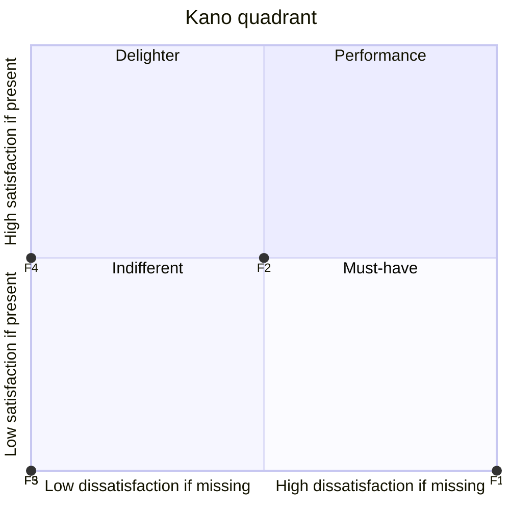
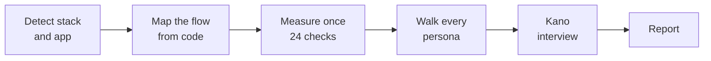

<p align="center">
  
</p>

<h1 align="center">DayZero</h1>

<p align="center">
  <b>The synthetic crowd engine. Like Reddit, but you own the users.</b><br>
  Validate your PMF and get Kano Model reports using your own local LLM (Cursor/Claude) without exposing your code.
</p>

<p align="center">
  
  
  
  
</p>

---

You can ship a SaaS in a weekend now. Finding out whether anyone wants it still takes recruiting, calls, and a notebook full of maybes, so most builders skip it and launch into silence.

DayZero puts a crowd of opinionated, hard-to-please people inside your IDE. They read your actual code, walk your actual signup flow, and tell you where they quit and why. You get the answer before you spend a single real user on it.

## 1 command, 1 real run

We pointed DayZero at **Tickly**, a small Next.js todo app from our test set, and typed 1 line in Claude Code:

```
@.dayzero validate
```

About 4 minutes later, read-only, this came back:

> **Verdict: FIX** · Stack `nextjs-react` · Flow `first_value` · 3 personas, directional

> "4 required fields and a company name for a todo list? It's just me, and I'm closing the tab."
> **Dev Malik**, indie hacker, at step 2: Sign up

> "4 required fields and no SSO. I'm not opening a security review for a todo list."
> **Rachel Okafor**, burned-out PM, at step 2: Sign up

> "No phone number, no address, nothing. Who do I call when this breaks? I'm not signing up for that."
> **Gary Hollis**, skeptical business owner, at step 1: Landing

And the line that mattered most:

> **Fix first:** email verification is a dead end. `middleware.ts` sends every unverified user back to `/verify-email`, and no file in the repo ever sets the verified cookie. Until that changes, 0% of real signups reach the dashboard.

Nobody planted that bug. The crowd found it by reading the code.

## Quick start

**1. Copy `.dayzero/` into the root of your project.**

```
your-project/
├── .dayzero/
├── src/
└── ...
```

**2. Ask your assistant.** In Cursor or Claude Code:

```
@.dayzero validate
```

**3. Open the report** at `.dayzero/reports/dayzero-report-YYYY-MM-DD.md`.

That's the whole install. There is no package, no server, and no script that runs on its own.

## What's in the report

| Section | What you learn |
|---|---|
| **Executive summary** | SHIP, FIX, or KILL. How many personas reached first value. The 1 change to make first, tied to a file. |
| **Funnel** | Every step of your flow with the file behind it, a measurement sheet (clicks, form fields, OAuth, price, permissions, contrast and more), and who left where, by which rule. |
| **Kano matrix** | Your 5 core features classified as Must-have, Performance, Delighter, Indifferent, or Reverse, with Better/Worse coefficients and a quadrant chart. |
| **Kano interview** | Each persona's answer to each feature from a fixed list, plus the few who broke from the crowd, in their own words. |
| **Top 3 quotes** | The lines you will remember in the shower. |

Here is the quadrant from the Tickly run, exactly as the report draws it:



F1 is todo capture (Must-have), F2 email reminders, F3 team invites (Reverse for 2 of 3), F4 AI prioritize, F5 streaks and badges.

## How it works

<p align="center">
  
</p>

DayZero is a folder of Markdown and JSON. Your assistant reads `system_protocol.md` and runs it like a program, on your machine, with your model.



1. **Detect** the stack and the app, then load the matching guide from `.dayzero/stacks/`.
2. **Map** the flow you asked for, step by step, each step tied to a file.
3. **Measure** the product once against 24 shared definitions in `measurements.json`. Every persona judges the same numbers, so runs stay comparable.
4. **Walk** each persona through the flow. Their rules fire on the measured values and decide where they quit.
5. **Interview** each persona about each feature with the 2 Kano questions. Answers come from 1 fixed list of 5 lines. Only a persona who breaks from the crowd, or from its own profile, answers in its own words.
6. **Report**, following the template section by section.

The personas run in Critic Mode. Praise, hedging, and compliment sandwiches are banned. A persona with a 3-click budget leaves at click 4, however nice the feature behind it is.

## The crowd

The free Community Edition ships 3 personas, each one built to fail a different kind of product:

| Persona | Who | Leaves when |
|---|---|---|
| `indie_hacker` | Solo founder, $400 MRR, 1am product hunter | Signup asks for more than email and password, or a free trial needs a card |
| `tired_pm` | Senior PM at a 400-person B2B company, burned out | First value takes more than 3 clicks, or the first screen is empty |
| `skeptical_boomer` | Owns a 12-person HVAC business, reads every word | The product asks for data before explaining why, or there is no human to call |

3 voices give you a direction. For distributions you can argue about in a roadmap meeting, the **Pro Pack** adds a much larger crowd (50+ at launch) across roles, incomes, devices, and markets: a nurse on a 12-hour shift, a courier paid per drop, a DevSecOps lead who rejects anything without SSO, a 74-year-old patient who fears popups. Same schema, same protocol. Unzip into `.dayzero/personas/`.

Pricing is on request. Open an issue with the **Pro license request** template.

## Commands

| Command | What it does |
|---|---|
| `@.dayzero validate` | Full run on the new-user flow |
| `@.dayzero validate --flow upgrade` | Walk 1 named flow: `first_value` (default), `upgrade`, `invite`, `return` |
| `@.dayzero validate --app apps/mobile` | In a repo with several apps, test 1 of them |
| `@.dayzero validate --persona tired_pm` | Run with 1 persona |
| `@.dayzero validate --feature "Checkout"` | Kano interview for 1 feature |
| `@.dayzero validate --funnel-only` | Funnel only, no Kano |
| `@.dayzero validate --test-rules` | Check every persona rule against its test snippets |

## Supported stacks

| Stack | Detected by |
|---|---|
| Next.js and React web | `app/layout.tsx`, `pages/_app.tsx`, or `createRoot(` |
| Flutter | `lib/main.dart` with `runApp(` |
| iOS SwiftUI | a `@main` type conforming to `App` |
| React Native and Expo | `expo` + `react-native` in `package.json`, `app.json` with an `expo` key |
| Native Android | `AndroidManifest.xml` launcher activity + an `Activity` class |
| Vue and Nuxt | `nuxt.config.ts`, or `createApp(` with a `.vue` root |
| SvelteKit | `svelte.config.js` + `src/routes/+page.svelte` |
| CLI tools and backend APIs | `bin` in `package.json`, `[project.scripts]`, Go `main` with cobra, or a server entry |

Detection order lives in [`detect.json`](.dayzero/stacks/detect.json). When an app has its own server folder, the CLI and API guide loads next to the main guide, and the report header names which guide read what.

We tested each one on its own fixture app. In those runs DayZero picked the right stack every time, cited a real file for every flow step, and inferred at most 11% of its measurements.

Any other stack runs on a generic guide, and the report says `Stack: unknown` up front. In a monorepo, DayZero picks the app with the most screen, navigation, and form files and lists the others with a ready `--app` command. If a flow is missing or only half-built (for example a checkout that never marks the user as paid), the report says so instead of inventing the missing steps.

## Write your own persona

A persona is 1 JSON file in `.dayzero/personas/` that passes [`persona.schema.json`](.dayzero/personas/persona.schema.json). Its behaviour lives in `rules`. Example only:

```json
{
  "id": "signup.too_many_fields",
  "category": "funnel",
  "measurement": "form_fields",
  "comparison": ">",
  "threshold": 3,
  "scope": { "type": "step", "step_role": "signup" },
  "effect": { "type": "drop" },
  "evidence": "signup form component",
  "priority": 2,
  "source": { "type": "heuristic" },
  "tests": {
    "positive": "tests/my_persona/signup.too_many_fields.pos.md",
    "negative": "tests/my_persona/signup.too_many_fields.neg.md"
  },
  "reaction": "4 fields to try a todo app? No."
}
```

Each rule reads 1 measurement from [`measurements.json`](.dayzero/measurements.json), compares it to a threshold, and has 1 effect: the persona drops, a Kano answer is forced or capped, or the run just flags it. It ships with 2 test snippets, 1 where it must fire and 1 where it must stay quiet. Check them with `@.dayzero validate --test-rules`.

Personas written for v1.0, with a free-text `inference_rule`, still run. Their results are labelled `legacy, unmeasured`.

## Privacy

- The protocol forbids sending code or reports to any URL or API.
- The assistant reads your repo read-only and writes exactly 1 file: the report.
- Your code goes only where your assistant already sends it.

## Honest limits

- Synthetic respondents are not customers. Use the report to filter ideas, then talk to real people before you bet on one.
- 3 personas give a directional signal. The report labels its own confidence by crowd size.
- The model behind your assistant sets the ceiling on quality.
- The 3 bundled personas still use the v1.0 free-text format, so their Kano answers vary from run to run. Personas with structured rules hold steadier.

## Contributing

- **New persona:** a PR with 1 JSON file that passes the schema, plus its rule tests.
- **New stack:** a PR with 1 guide in `.dayzero/stacks/` that follows the 12 sections of `_generic.md`.
- **Protocol change:** open an issue first and describe the run that went wrong.

<p align="center">
  <a href="VISION.md">Vision</a> · <a href=".dayzero/system_protocol.md">Protocol</a> · <a href="CHANGELOG.md">Changelog</a>
</p>
